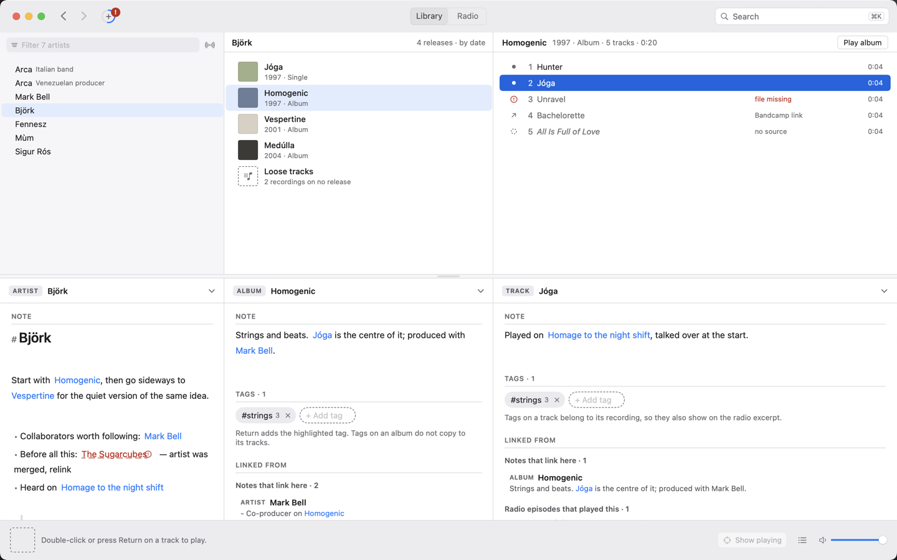
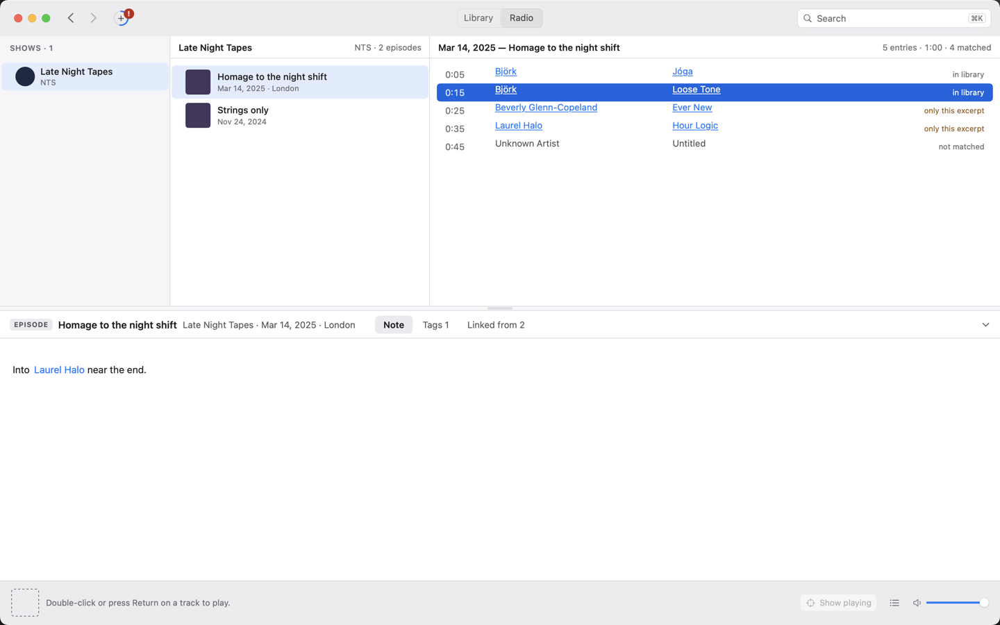
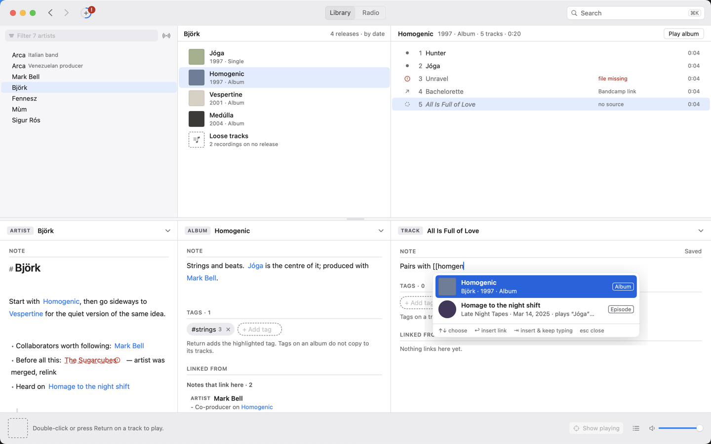
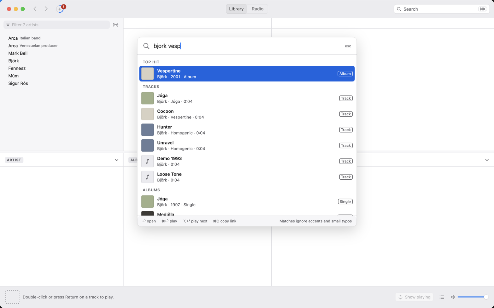
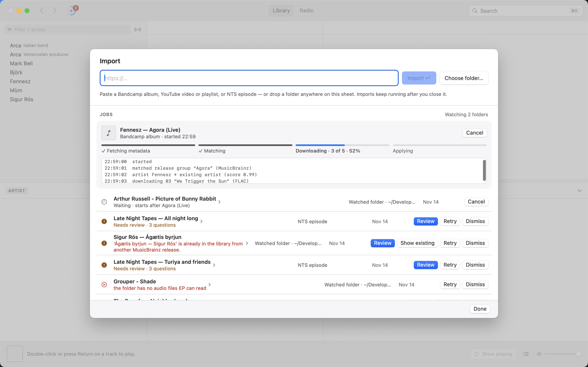

# EP

A music library manager with Obsidian-style notes and links: a FastAPI/Postgres server
(`server/`) and a native macOS app (`app/`). Imports from folders, Bandcamp, YouTube and
NTS radio episodes, matched against MusicBrainz; audio files are never modified.



| | |
|---|---|
|  |  |
|  |  |

## Run the server

Needs Docker. From `server/`:

```sh
docker compose up -d --build
docker compose run --rm api alembic upgrade head
curl localhost:8000/health
```

The API listens on `localhost:8000`. It mounts `~/Music/ep-Library` (managed library) and
`~/Music/Library` (watched, read-only). Details and settings: [`server/README.md`](server/README.md).

## Build and run the macOS app

Needs Xcode 26 (macOS 15 or later). From the repo root:

```sh
app/scripts/build.sh                        # Debug build
app/scripts/run.sh                          # run against localhost:8000
app/scripts/run.sh http://host:8000         # or another server
```

Or open `app/EP.xcodeproj` in Xcode and run the `EP` scheme. Details: [`app/README.md`](app/README.md).
